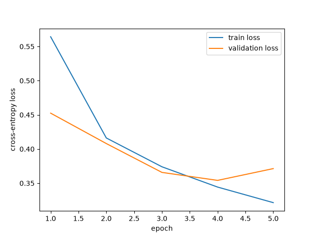

# Fashion-MNIST Clothing Classifier Prototype

A PyTorch prototype for an online clothing retailer that wants to explore
automatically assigning broad product categories to small grayscale catalog
images. This is an understandable prototype and experiment, not a production
image-recognition service.

## Setup

```
python -m pip install -r requirements.txt
python fashion_mnist.py
```

The script downloads Fashion-MNIST through Torchvision on first run, trains
the baseline model, runs one controlled experiment, evaluates on the test
set, and writes `loss_curves.png` and `results.csv`.

## Data and tensor pipeline

Fashion-MNIST contains 60,000 training images and 10,000 test images. Each
image is a 28 by 28 grayscale picture assigned to one of 10 clothing
categories: T-shirt/top, Trouser, Pullover, Dress, Coat, Sandal, Shirt,
Sneaker, Bag, Ankle boot.

The data is loaded with the official Torchvision interface and converted
to tensors with `transforms.ToTensor()`, which turns each image into a
tensor of shape 1 by 28 by 28 with pixel values between 0 and 1.

The 60,000 training images are split into 50,000 training images and
10,000 validation images with a fixed seed, so the split is the same on
every run. The 10,000 test images are kept untouched until the final
evaluation. The test set played no part in choosing the architecture, the
learning rate, or the number of epochs.

DataLoaders feed the model in batches of 64 images. Training batches are
shuffled so the model does not learn the order of the images.

## Model and training choices

The network is a simple multi-layer perceptron defined as its own
`nn.Module`:

- Flatten the image into 784 numbers (28 times 28 pixels)
- Linear layer: 784 to 128 hidden units
- ReLU activation
- Linear layer: 128 to 10 outputs, one score per clothing category

ReLU is used for the hidden layer because it keeps positive values and
turns negative values to zero. It lets the network learn non-linear
patterns while keeping gradients healthy. The output layer has no
activation because CrossEntropyLoss expects raw scores.

Training uses CrossEntropyLoss and the Adam optimizer. Each batch does a
forward pass, measures the loss, computes gradients with backward, and
updates the weights with the optimizer. Both runs train for 5 epochs.

## Results

### Baseline run: Adam learning rate 0.001

| Epoch | Train loss | Validation loss | Validation accuracy |
|------:|-----------:|----------------:|--------------------:|
| 1 | 0.5643 | 0.4525 | 0.8391 |
| 2 | 0.4162 | 0.4080 | 0.8600 |
| 3 | 0.3740 | 0.3658 | 0.8675 |
| 4 | 0.3443 | 0.3541 | 0.8730 |
| 5 | 0.3215 | 0.3713 | 0.8660 |

Final test accuracy (baseline): 0.8561

### What the pattern means

Training loss fell every epoch, and validation loss fell through epoch 4,
so the network was genuinely learning. At epoch 5 the training loss kept
falling but the validation loss rose slightly, from 0.3541 to 0.3713, and
validation accuracy dipped from 0.8730 to 0.8660. That is the first small
sign of overfitting: the model kept improving on the images it trains on
while getting slightly worse on images it has not seen. The effect is
mild, not severe, and the overall pattern is continued learning with a
hint of overfitting at the end. It is not underfitting, because accuracy
is far above guessing, and it is not unstable, because neither curve
jumps around.



## Controlled experiment: learning rate

Only one characteristic changed: the learning rate, from 0.001 to 0.01.
Everything else stayed identical: the same split, the same architecture,
the same batch size, the same 5 epochs, the same seed.

### Prediction, written before the experiment run

With learning rate 0.01 the model should learn faster at first, because
each weight update takes a bigger step toward lower loss. But bigger
steps can also overshoot the best weights, so I predicted the validation
loss would bounce around more, finish higher than the baseline, and the
final validation accuracy would be similar or slightly lower than the
baseline.

### Experiment run: Adam learning rate 0.01

| Epoch | Train loss | Validation loss | Validation accuracy |
|------:|-----------:|----------------:|--------------------:|
| 1 | 0.5202 | 0.4911 | 0.8210 |
| 2 | 0.4182 | 0.4691 | 0.8187 |
| 3 | 0.3876 | 0.4375 | 0.8476 |
| 4 | 0.3671 | 0.3802 | 0.8634 |
| 5 | 0.3602 | 0.3762 | 0.8685 |

Final test accuracy (experiment): 0.8550

### Comparison with the prediction

The prediction was partly right. The experiment finished slightly worse
than the baseline: validation loss 0.3762 against the baseline best of
0.3541, validation accuracy 0.8685 against 0.8730, and test accuracy
0.8550 against 0.8561. But the instability I predicted did not happen.
The experiment validation loss fell smoothly every epoch, with no
bouncing, and its first-epoch training loss was actually lower than the
baseline. So a learning rate of 0.01 was stable here, just consistently a
little worse. What I learned: a bigger step size does not automatically
mean unstable training, and for this small network the lower learning
rate of 0.001 is the better choice.

## Recommendation

Before considering a larger prototype, test two things in this order.
First, train the baseline longer with early stopping: the baseline was
still improving at epoch 4, so a few more epochs with a checkpoint saved
at the best validation loss would show whether epoch 5 was a real turning
point or just noise. Second, try a slightly larger hidden layer, 256
units instead of 128, at the baseline learning rate of 0.001, and compare
on validation only. If neither change clearly beats 0.8730 validation
accuracy, the next step worth testing is a small convolutional network,
which is designed for image patterns rather than flattened pixels.

## Dataset citation

Xiao, H., Rasul, K., and Vollgraf, R. (2017). Fashion-MNIST: A Novel Image Dataset for Benchmarking Machine Learning Algorithms. arXiv:1708.07747. The dataset is distributed under the MIT License.
